# Diagrama de clases del dominio: Candela Motors

Este diagrama muestra las clases de la capa de dominio (`backend/app/domain/`). Está dividido en nueve partes para que se pueda leer bien. Las fuentes en Mermaid están en `docs/uml/fuentes/`; si algo cambia, se edita la fuente y se vuelve a exportar la imagen.

El alcance completo está en [docs/alcance.md](../alcance.md).

## 1. Catálogo de motos

Las motos son de tres marcas fijas (Honda, Kawasaki y Yamaha), y cada `Marca` guarda su color para pintar la página. `Moto` sabe si está disponible, si sirve para una licencia (A1 hasta 125 cc, A2 más de 125 cc) y cuánto vale en dólares con la TRM. `PlanCredito` es un value object: calcula la cuota con la fórmula de cuota fija y, al revés, el precio máximo que alcanza para una cuota (`precio_maximo_para_cuota`), que es la base de "buscar por cuota". Cada búsqueda se guarda sin datos personales en `Busqueda` para el radar de demanda.

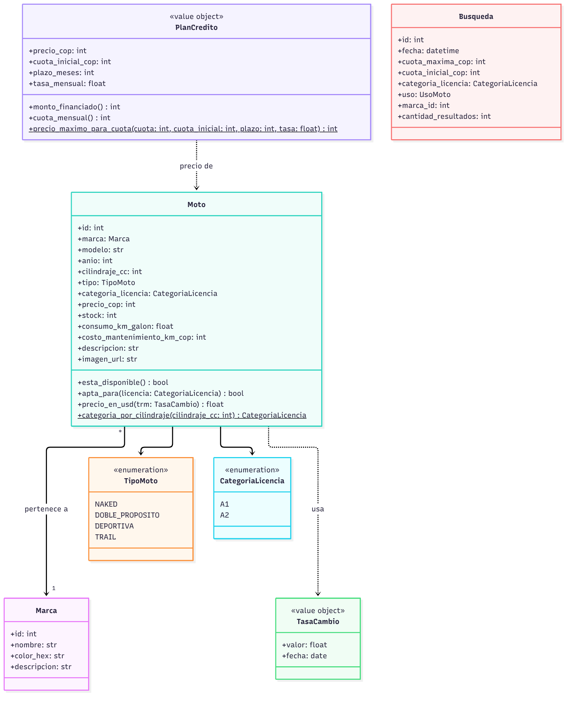

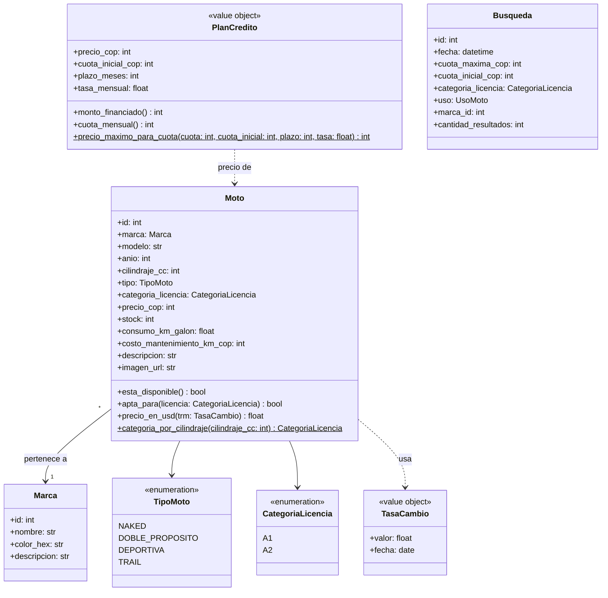

## 2. Costo real de tener la moto

`CalculadoraCostoReal` es un servicio de dominio. Junta la moto, el plan de crédito, el perfil de uso y los parámetros que configura el administrador, y devuelve un `CostoMensual` con el desglose: cuota, gasolina, SOAT, mantenimiento e impuesto. El costo de mantenimiento por kilómetro está en cada moto, y el SOAT sale de la tabla `TarifaSoat` según el cilindraje. Con el perfil de uso también calcula en cuántos meses se paga la moto cuando se usa para trabajar.

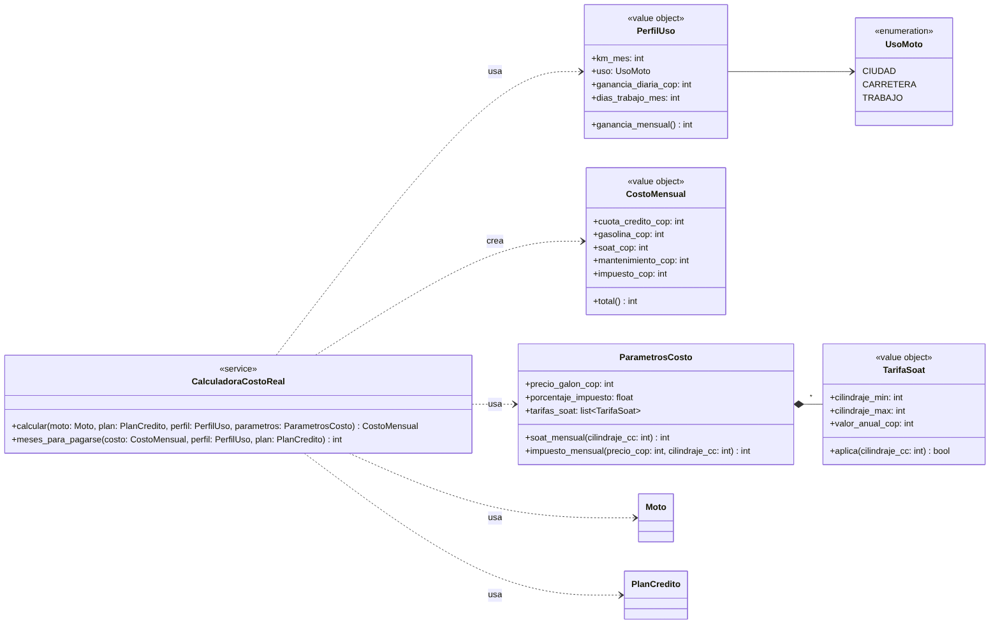

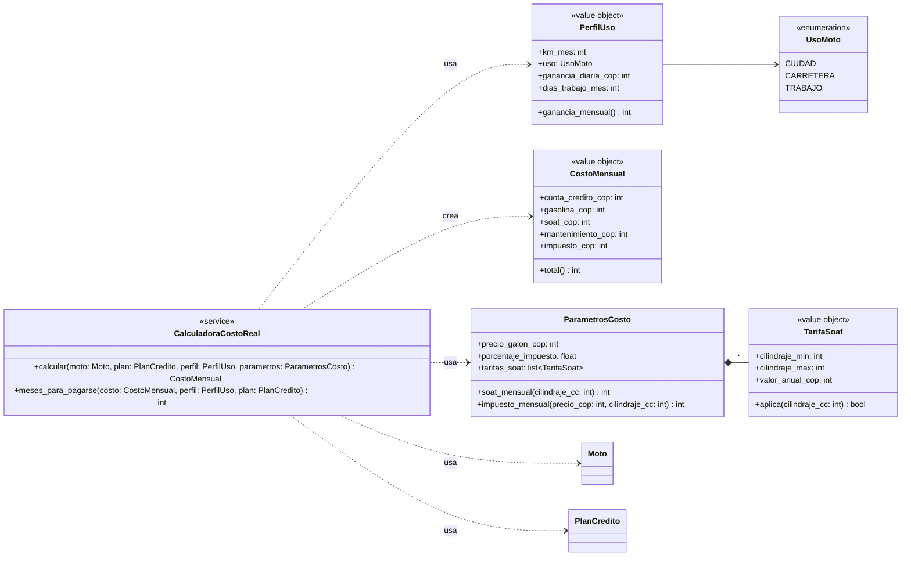

## 3. Atención personalizada

Un `Cliente` es la persona que cotiza o pide un test drive; puede tener una cuenta (`Usuario` con rol `CLIENTE`) o no. Los asesores también son usuarios, con rol `ASESOR` y una marca de especialidad. `AsignadorAsesor` elige al asesor de la marca con menos atenciones abiertas, y `GeneradorCodigo` crea el código de seguimiento (`CM-XXXX`). La `Cotizacion` avanza por los estados de `EstadoAtencion` con `cambiar_estado`, que no deja hacer saltos inválidos.

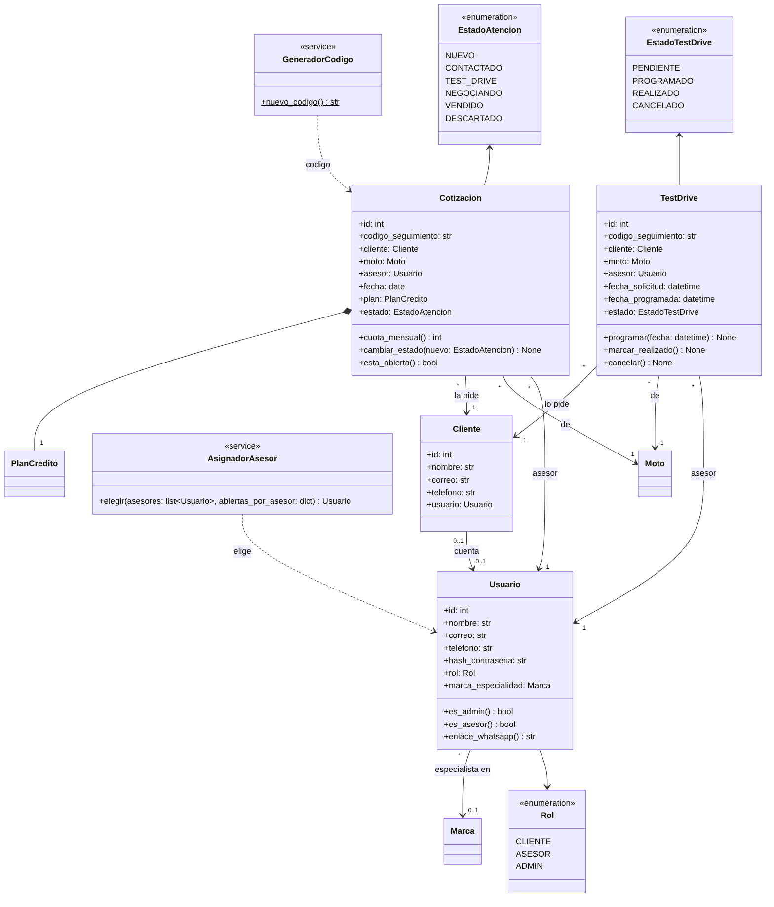

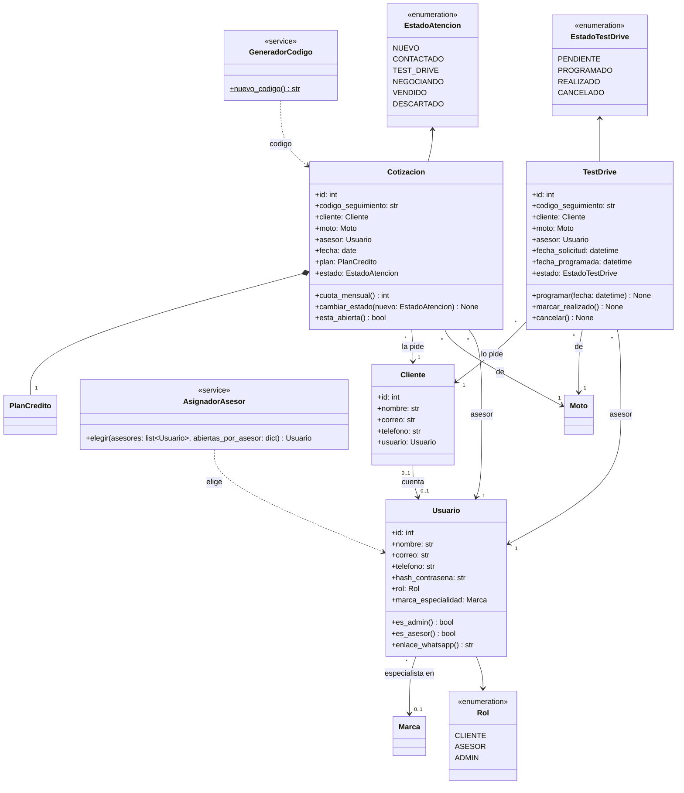

## 4. Tienda de accesorios

Un `Accesorio` puede servir para muchas motos y una moto acepta muchos accesorios (relación muchos a muchos). El `Pedido` se compone de `ItemPedido`, y cada ítem guarda el precio del día en que se compró. El pedido sabe si su reserva de stock ya venció (`reserva_vencida`). La `Direccion` usa los municipios y departamentos oficiales, y el departamento define el costo y los días de envío.

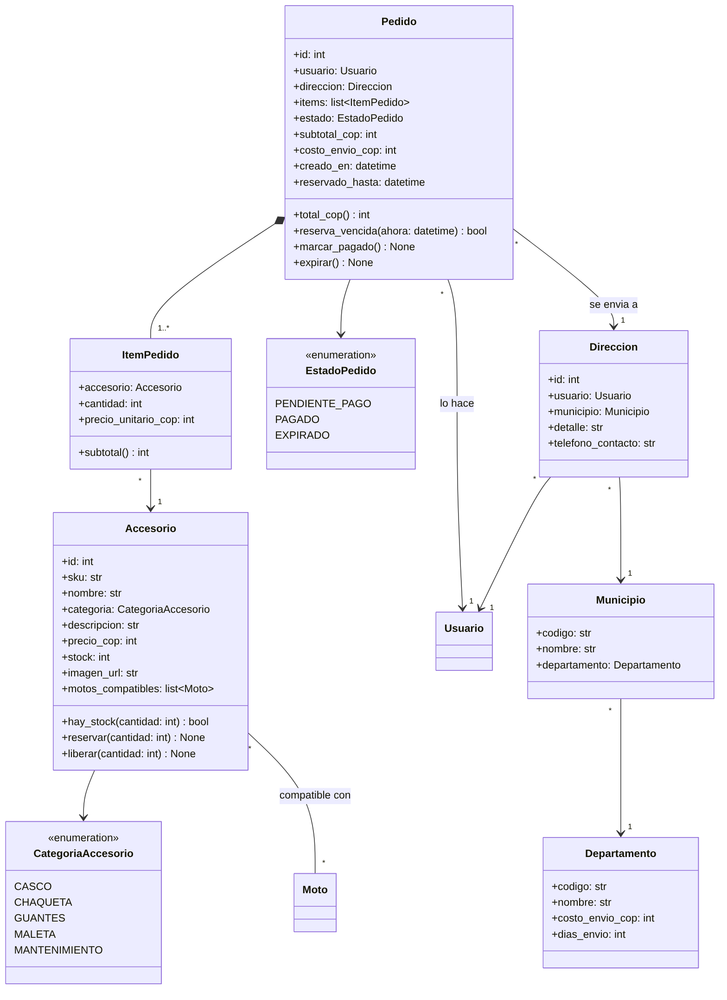

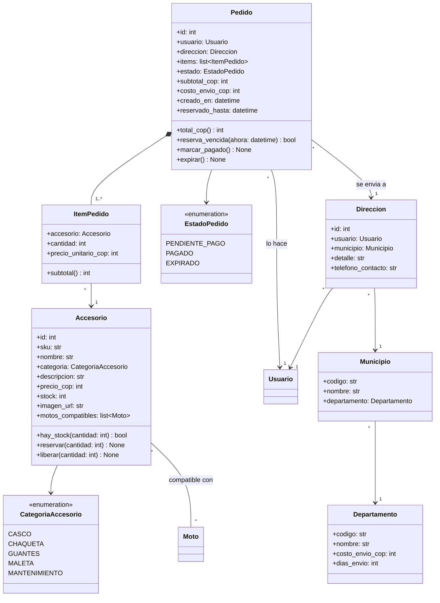

## 5. Pagos y envíos

Un pedido puede tener varios intentos de `Pago` (si el primero es rechazado). `ResultadoPago` es lo que responde la pasarela (Wompi): con él se aprueba o se rechaza el pago. Cuando el pago queda aprobado se crea el `Envio`, que guarda cada cambio de estado como un `EventoEnvio`; así el cliente ve la línea de tiempo de su pedido.

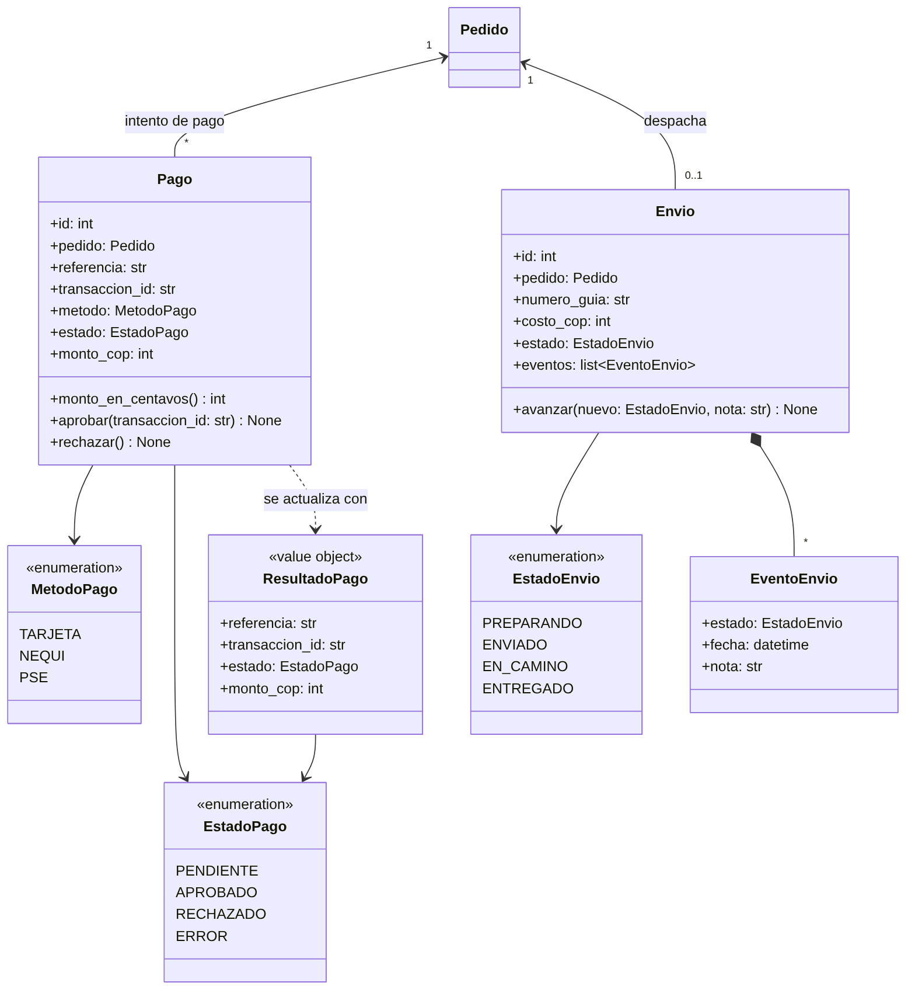

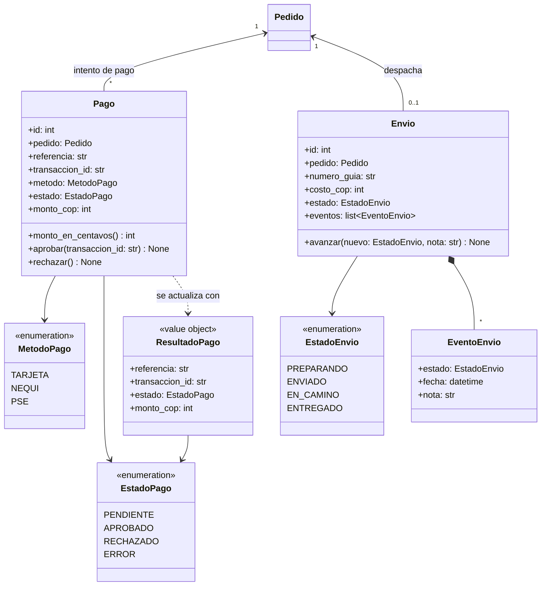

## 6. Puertos: motos y atención

Los puertos son interfaces (clases abstractas con `abc.ABC`) que el dominio define y la infraestructura implementa. Laura implementa los repositorios con SQLAlchemy y Nicolás implementa `ProveedorTasaCambio` con la API de la TRM. `contar_abiertas_por_asesor` le da al `AsignadorAsesor` los datos para elegir asesor.

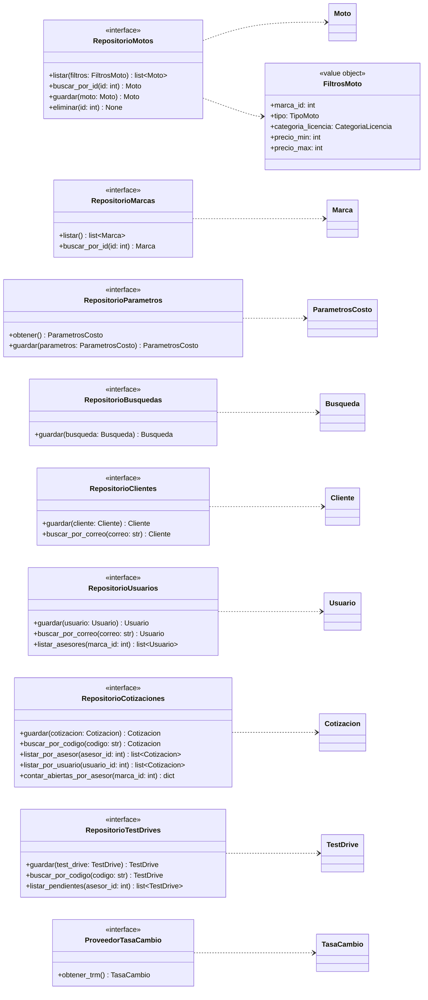

## 7. Puertos: tienda, pagos y envíos

`RepositorioPedidos.crear_con_reserva` guarda el pedido, sus ítems y descuenta el stock en una sola transacción: si algo falla, no queda nada a medias. `RepositorioPagos.registrar_evento` devuelve `False` si ese aviso de Wompi ya había llegado, para no procesarlo dos veces. `PasarelaPago` es el puerto que Nicolás implementa con Wompi: arma los datos del widget, lee el aviso (validando la firma) y consulta una transacción.

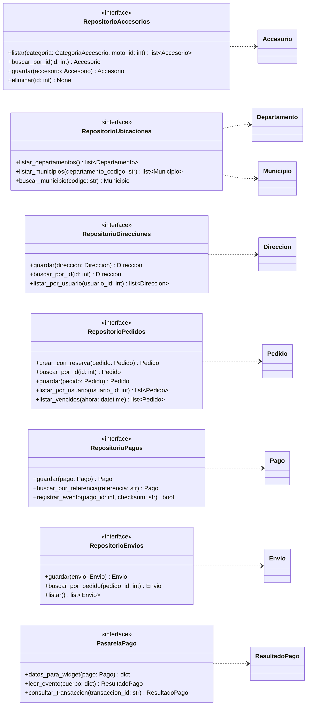

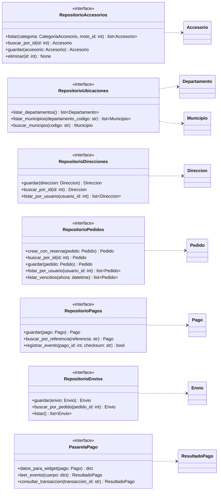

## 8. Excepciones

Todas las excepciones del dominio heredan de `DominioError`. La API las convierte en respuestas HTTP: `EntidadNoEncontradaError` en 404, `StockInsuficienteError` y `TransicionInvalidaError` en 409, `FirmaInvalidaError` en 401, y las demás de validación en 422.

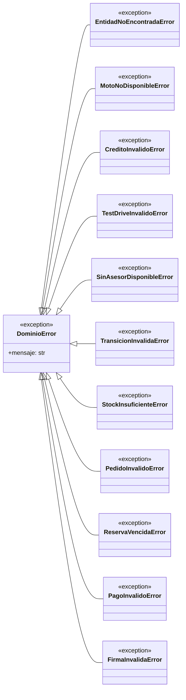

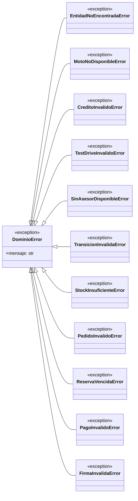

## 9. Estructuras de datos

| Estructura | Para qué se usa | Complejidad |
| --- | --- | --- |
| ColaTestDrives | Atender los test drives de un asesor en el orden en que se pidieron (FIFO) | encolar y desencolar O(1) |
| AgendaTestDrives | Guardar una cola por asesor y atender al siguiente de cada uno | encontrar la cola del asesor O(1) en promedio |
| PilaSimulaciones | Deshacer la última simulación en el simulador de crédito | apilar y desapilar O(1) |
| ArbolMotosPorPrecio | Encontrar las motos que alcanzan con la cuota del cliente (árbol binario de búsqueda por precio) | insertar y buscar O(log n) en promedio, O(n) en el peor caso; buscar un rango O(log n + k) |

La cola y la pila están hechas con nodos enlazados, sin usar `list.pop(0)` ni `collections.deque`.

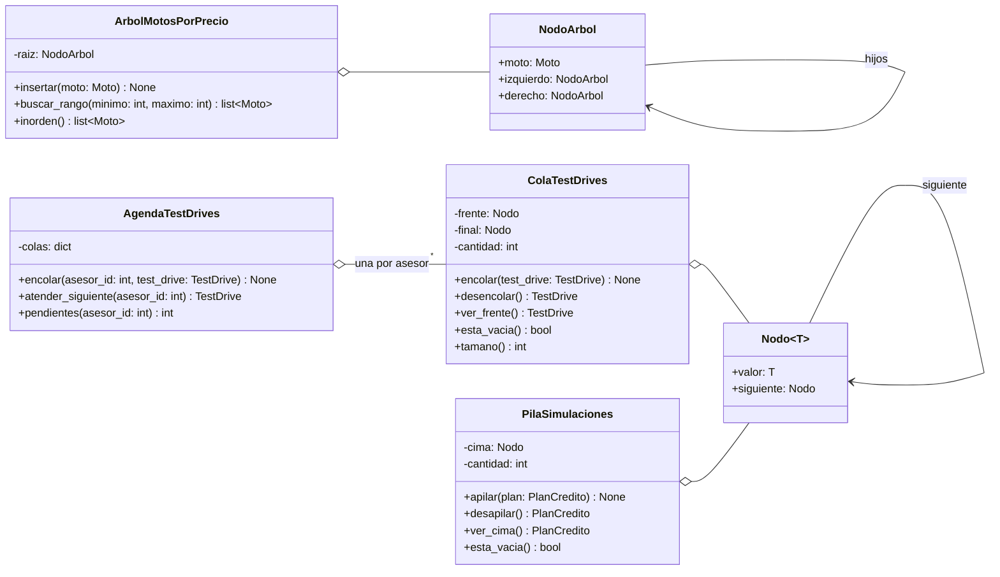
