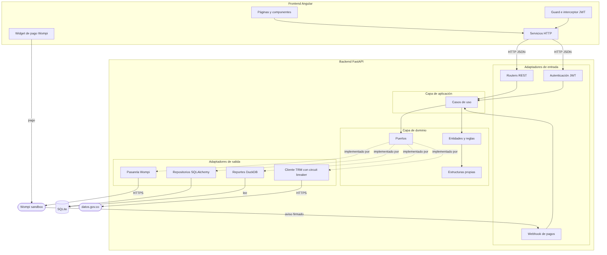
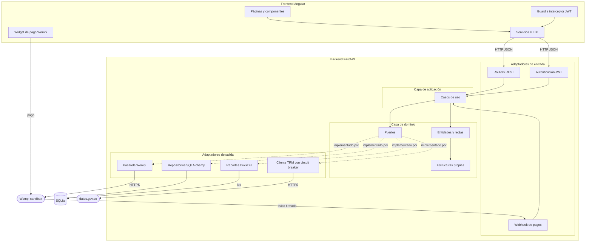
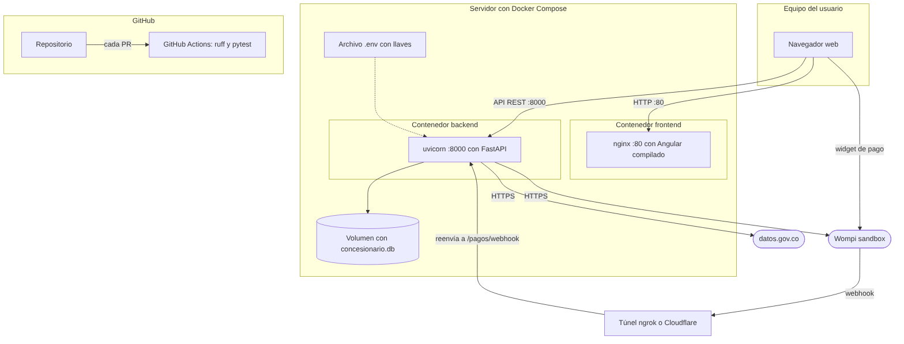
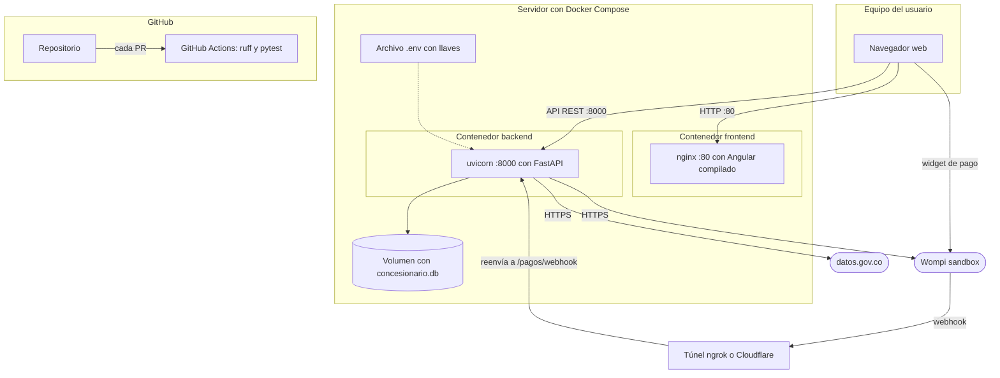

# Diagramas de componentes y despliegue: Candela Motors

Las fuentes en Mermaid están en `docs/uml/fuentes/`. Si algo cambia, se edita la fuente y se vuelve a exportar la imagen.

## 1. Diagrama de componentes

Muestra cómo está armado el sistema por dentro con la arquitectura hexagonal.

- **Frontend Angular:** las páginas usan servicios HTTP para hablar con la API. Un guard y un interceptor ponen el token JWT en cada petición. El widget de Wompi se abre en el navegador y el pago va directo a Wompi, así los datos de la tarjeta nunca pasan por nuestro backend.
- **Adaptadores de entrada:** los routers REST, la autenticación JWT y el webhook de pagos. Solo reciben la petición, validan los datos y llaman al caso de uso.
- **Capa de aplicación:** los casos de uso, que coordinan el trabajo usando los puertos.
- **Capa de dominio:** las entidades con sus reglas, los puertos (interfaces) y las estructuras propias (cola, pila y árbol). No depende de ninguna otra capa.
- **Adaptadores de salida:** implementan los puertos. Los repositorios usan SQLAlchemy sobre SQLite, los reportes usan DuckDB, el cliente de la TRM consulta datos.gov.co con circuit breaker y la pasarela habla con Wompi.

La flecha punteada "implementado por" es la idea central de la arquitectura hexagonal: el dominio define qué necesita (el puerto) y la infraestructura decide cómo se hace. Por eso podemos cambiar SQLite por otra base de datos, o Wompi por otra pasarela, sin tocar el dominio.

## 2. Diagrama de despliegue

Muestra dónde corre cada parte cuando el sistema está funcionando.

- **Equipo del usuario:** el navegador descarga la página desde nginx y llama a la API en el puerto 8000.
- **Servidor con Docker Compose:** dos contenedores, uno con nginx sirviendo Angular ya compilado y otro con uvicorn corriendo FastAPI. La base de datos SQLite queda en un volumen para que no se pierda al reiniciar los contenedores. Las llaves de Wompi y el secreto del JWT se leen del archivo `.env`, que nunca se sube al repositorio.
- **Servicios externos:** el backend consulta la TRM en datos.gov.co y la API de Wompi en ambiente de pruebas. Wompi avisa el resultado del pago con un webhook, y como trabajamos en un computador local se usa un túnel (ngrok o Cloudflare Tunnel) que reenvía ese aviso a `/pagos/webhook`.
- **GitHub:** en cada pull request, GitHub Actions corre `ruff` y `pytest`.

